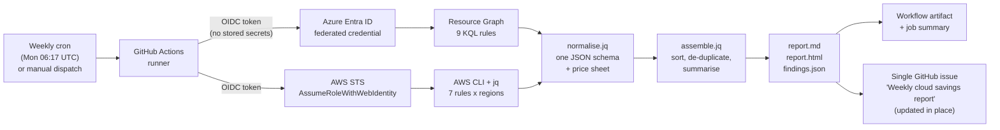
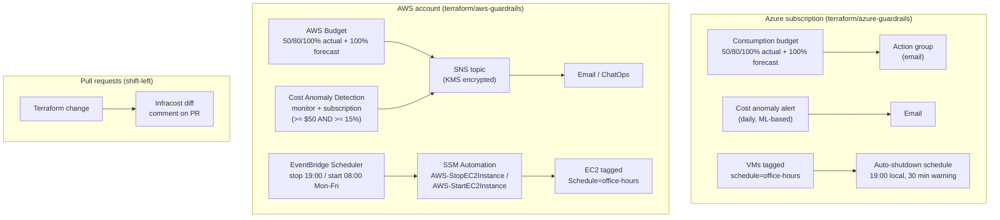

# cloud-cost-guardian

[](https://github.com/rsk071216-stack/cloud-cost-guardian/actions/workflows/ci.yml)
-0078D4?logo=microsoftazure&logoColor=white)


[](LICENSE)

**Find the money your Azure and AWS accounts are wasting, every week, without giving anyone write access.**

cloud-cost-guardian runs 16 read-only detection rules across Azure and AWS, prices every finding,
ranks them by estimated monthly saving and posts the top items to a GitHub issue every Monday.
Terraform guardrails (budgets, anomaly alerts, office-hours shutdown) stop the waste from coming back.

> On the synthetic sample estate in [`tests/fixtures`](tests/fixtures), one scan finds
> **about $1,590 per month (about $19,080 per year)** of savings across 33 actionable findings.
> See the full [sample report](docs/sample-report.md).

---

## The problem this solves

Industry surveys (for example the Flexera State of the Cloud reports and FinOps Foundation research)
consistently estimate that **roughly 20-30% of cloud spend is wasted**. That is an industry estimate, not a
statement about your account, but the causes are the same everywhere:

- disks, IPs and snapshots left behind when a VM or project is deleted
- dev and test machines running nights and weekends
- VMs that were "stopped" from inside the OS and are still billed for compute
- previous-generation SKUs (gp2, Dv2, Av2) that cost more for less performance
- nobody gets an alert until the invoice arrives

Most of this is invisible in the monthly bill because it is spread across hundreds of small line items.
This repository turns it into a ranked to-do list with a dollar value and a risk level on every line.

## How it works

### Weekly scan pipeline



### Guardrails architecture



## Rules catalogue

All rules are declared once in [`rules/catalogue.json`](rules/catalogue.json) (id, severity, risk,
savings formula, remediation). Each query file starts with a header explaining what it finds, why it
costs money, the typical saving, remediation and risk.

| ID | Cloud | What it finds | Typical saving | Risk |
|---|---|---|---|---|
| `az-unattached-disk` | Azure | Managed disks with no VM attached | 100% of disk cost ($5-$135+/disk/month) | Medium |
| `az-unassociated-public-ip` | Azure | Standard/static public IPs not attached to anything | ~$3.65/IP/month | Low |
| `az-stopped-vm-billed` | Azure | VMs "stopped" but not deallocated (compute still billed) and deallocated VMs still paying for disks | Full compute + disk cost | Low |
| `az-old-snapshot` | Azure | Snapshots older than 90 days | $0.05-$0.12/GB/month | Medium |
| `az-empty-app-service-plan` | Azure | Paid App Service plans hosting zero apps | $13-$450+/plan/month | Low |
| `az-idle-load-balancer` | Azure | Standard load balancers with rules but no backends | ~$18/LB/month | Low |
| `az-legacy-vm-sku` | Azure | Running VMs on A/Av2/Dv2/DSv2/Dv3/Ev3/Fs/G families | 10-20% of VM cost | Medium |
| `az-untagged-resource` | Azure | Billable resources missing owner / cost-center / environment tags | Enables showback | Low |
| `az-orphaned-nic` | Azure | NICs not attached to a VM or private endpoint | Hygiene, frees billed IPs | Low |
| `aws-unattached-ebs` | AWS | EBS volumes in the `available` state | 100% of volume cost | Medium |
| `aws-unused-eip` | AWS | Elastic IPs with no association | ~$3.65/IP/month | Low |
| `aws-old-ebs-snapshot` | AWS | Snapshots older than 90 days (flags AMI-backed and AWS Backup-managed) | $0.05/GB/month | Medium |
| `aws-idle-nat-gateway` | AWS | NAT gateways that moved < 1 GiB in 14 days (CloudWatch) | ~$32.85/gateway/month | Medium |
| `aws-gp2-to-gp3` | AWS | In-use gp2 volumes (gp3 sized to match gp2 IOPS/throughput) | ~20% of volume cost | Low |
| `aws-stopped-ec2-volumes` | AWS | Instances stopped 7+ days still paying for EBS | 100% of attached volume cost | Medium |
| `aws-unused-load-balancer` | AWS | ALB/NLB/GWLB with zero registered targets, Classic LBs with no instances | $9-$18/LB/month | Low |

Risk is the risk of **acting** on the finding: Low = safe after a quick owner check, Medium = snapshot or
back up first, High = needs an owner decision (for example AMI-backed or AWS Backup-managed snapshots).

## What the report looks like

Excerpt from [`docs/sample-report.md`](docs/sample-report.md), generated by the test suite from the
fixtures (a self-contained [HTML version](docs/sample-report.html) is produced as well):

> **Estimated saving: $1,590.03 per month ($19,080.36 per year)** from 33 actionable findings.
>
> | # | Cloud | Resource | Region | Rule | Est. $/month | Risk | Recommendation |
> |---:|---|---|---|---|---:|---|---|
> | 1 | AWS | `db-migration-temp` | us-east-1 | `aws-unattached-ebs` | $285.00 | Medium | Snapshot if needed, then delete this unattached 200 GiB io1 volume. |
> | 2 | Azure | `asp-marketing-prod` | westeurope | `az-empty-app-service-plan` | $227.76 | Low | Delete the empty P1v3 App Service plan (2 worker(s)) or consolidate apps onto a shared plan. |
> | 3 | Azure | `vm-sap-sandbox` | westeurope | `az-stopped-vm-billed` | $207.36 | Medium | VM is deallocated but its 2 disk(s) still bill. Snapshot and delete if retired, or downgrade disks to Standard HDD while parked. |
> | 4 | Azure | `vm-build-agent-02` | westeurope | `az-stopped-vm-billed` | $157.44 | Low | VM is stopped but NOT deallocated, so compute is still billed. Deallocate it (az vm deallocate) or delete it. |
> | 5 | Azure | `vm-erp-legacy-01_DataDisk_0` | westeurope | `az-unattached-disk` | $138.24 | Medium | Snapshot if the data may be needed, then delete this unattached 1024 GB Premium_LRS disk. |
> | 15 | AWS | `api-prod-01-data` | us-east-1 | `aws-gp2-to-gp3` | $20.00 | Low | Modify to gp3 online: aws ec2 modify-volume --volume-id vol-0a1b2c3d4e5f60005 --volume-type gp3 --iops 6000 --throughput 250 |

Every finding follows one schema ([`schema/finding.schema.json`](schema/finding.schema.json)):

```json
{
  "provider": "aws",
  "rule_id": "aws-unattached-ebs",
  "resource_id": "vol-0a1b2c3d4e5f60002",
  "region": "us-east-1",
  "monthly_cost_estimate": 285,
  "recommendation": "Snapshot if needed, then delete this unattached 200 GiB io1 volume.",
  "risk": "medium",
  "evidence": { "volume_type": "io1", "size_gb": 200, "iops": 4000 }
}
```

## Quick start

### Option A: run locally (5 minutes)

Requirements: `bash`, `jq`, and `az` and/or `aws` logged in with read access.
Works in Azure Cloud Shell, AWS CloudShell, Linux, macOS and Git Bash on Windows.

```bash
git clone https://github.com/rsk071216-stack/cloud-cost-guardian.git
cd cloud-cost-guardian

az login                                   # Azure (Reader is enough)
az extension add --name resource-graph
aws sso login --profile my-readonly        # AWS (any read-only profile)
export AWS_PROFILE=my-readonly

bash scripts/scan.sh                                  # every logged-in cloud, all enabled AWS regions
bash scripts/scan.sh --provider aws --aws-regions us-east-1,eu-west-1
bash scripts/scan.sh --provider azure --azure-management-groups my-root-mg
bash scripts/scan.sh --rules az-unattached-disk,aws-unattached-ebs

open out/report.html   # or out/report.md, out/findings.json
```

`--provider all` (the default) skips a cloud that is not logged in; naming a provider explicitly makes
that a hard error. A rule that fails (for example AccessDenied in one region) is listed in the report
under "Rules that could not run" instead of aborting the scan.

### Option B: weekly in GitHub Actions with OIDC

1. Fork or copy this repository.
2. Create the read-only identities: follow [`docs/permissions.md`](docs/permissions.md)
   (Azure federated credential + Reader; AWS role from [`terraform/aws-scanner-access`](terraform/aws-scanner-access)).
3. Add repository **variables** (not secrets): `AZURE_CLIENT_ID`, `AZURE_TENANT_ID`, `AZURE_SUBSCRIPTION_ID`
   and/or `AWS_ROLE_ARN`, optionally `CCG_AWS_REGIONS`.
4. Run **Weekly cloud cost scan** once from the Actions tab. It then runs every Monday, uploads the
   `cost-report` artifact, writes the report to the job summary and creates or updates a single issue
   titled **Weekly cloud savings report**.

With no variables configured the workflow finishes green with a notice, so it never breaks CI.

## Required permissions (read-only)

| Cloud | Grant | File |
|---|---|---|
| Azure | Built-in `Reader`, or the custom role (19 `*/read` actions, no data actions) at management group scope | [`permissions/azure/cost-guardian-reader-role.json`](permissions/azure/cost-guardian-reader-role.json) |
| Azure | Federated credential trusting only `repo:<owner>/<repo>:ref:refs/heads/main` | [`permissions/azure/github-federated-credential.json`](permissions/azure/github-federated-credential.json) |
| AWS | 10 `Describe*`/`Get*` actions | [`permissions/aws/cost-guardian-readonly-policy.json`](permissions/aws/cost-guardian-readonly-policy.json) |
| AWS | Trust policy: GitHub OIDC, exact audience and `sub` match | [`permissions/aws/github-oidc-trust-policy.json`](permissions/aws/github-oidc-trust-policy.json) |
| GitHub | `contents: read`, `id-token: write`, `issues: write` (this repo only) | [`.github/workflows/weekly-cost-scan.yml`](.github/workflows/weekly-cost-scan.yml) |

## Terraform guardrails

| Module | What it creates |
|---|---|
| [`terraform/azure-guardrails`](terraform/azure-guardrails) | Subscription budget (50/80/100% actual, 100% forecast) wired to an action group, Cost Management anomaly alert, daily auto-shutdown for every VM tagged `schedule=office-hours` |
| [`terraform/aws-guardrails`](terraform/aws-guardrails) | AWS Budget with actual + forecast alerts, Cost Anomaly Detection monitor and immediate subscription (impact >= $50 **and** >= 15%), KMS-encrypted SNS topic, EventBridge Scheduler + SSM Automation office-hours stop/start for EC2 tagged `Schedule=office-hours` (IAM limited to tagged instances) |
| [`terraform/aws-scanner-access`](terraform/aws-scanner-access) | GitHub OIDC provider and the read-only scanner role (policy loaded from `permissions/aws`) |

```bash
cd terraform/aws-guardrails
cp terraform.tfvars.example terraform.tfvars   # set emails, budget, time zone
terraform init && terraform plan && terraform apply
```

Office hours alone typically cut dev/test compute hours by about two thirds (running 55 of 168 hours a week).
Pull requests that touch `terraform/` get an Infracost cost-diff comment when the `INFRACOST_API_KEY`
secret is set; without it the job skips cleanly.

## Safety

- **Read-only by default.** The scanner only calls Resource Graph and `Describe*`/`Get*` APIs. The test
  suite's mocked CLIs reject anything else, and CI fails if the scanner tries.
- **No auto-delete.** Every finding is a recommendation with a risk level. Remediation is a human decision
  (see [ADR 0002](docs/adr/0002-recommend-never-delete.md)).
- **No stored cloud credentials.** OIDC federation, one-hour sessions, trust limited to the `main` branch.
- **Pinned supply chain.** Actions pinned by commit SHA, tool downloads verified by SHA-256, exact
  Terraform provider versions, Dependabot for updates.
- **Reports stay private.** `out/` is git-ignored; reports go to workflow artifacts (30-day retention).
  For a private client estate, run the workflow in a private repository.

## Design decisions

Architecture decision records in [`docs/adr`](docs/adr):

1. [Resource Graph and the AWS CLI instead of an SDK application](docs/adr/0001-resource-graph-and-cli-instead-of-an-sdk.md)
2. [Recommend, never remediate automatically](docs/adr/0002-recommend-never-delete.md)
3. [Estimate savings from a versioned list-price sheet](docs/adr/0003-list-price-estimates.md)
4. [OIDC federation only, no stored cloud credentials](docs/adr/0004-oidc-federation-only.md)
5. [Golden-file tests with mocked cloud CLIs](docs/adr/0005-golden-file-tests-with-mocked-clis.md)

## Cost review engagement: how I work with clients

| Step | What happens | You get |
|---|---|---|
| 1. Discovery (30-60 min call) | Spend profile, environments, owners, constraints (compliance, change windows, reservations) | Agreed scope and success metric |
| 2. Read-only scan | You grant `Reader` / the read-only role (or run the scan yourself and share the report) | No write access ever requested |
| 3. Savings report | Findings ranked by dollar value and risk, tuned to your region and discounts, plus Cost Management / Cost Explorer review | Prioritised report with owners |
| 4. Quick wins | Low-risk items first (unattached disks, idle IPs, gp2 to gp3, stopped-not-deallocated VMs) through your change process | Savings visible on the next invoice |
| 5. Guardrails | Budgets, anomaly alerts, tagging policy, office-hours schedules, weekly scan and Infracost in PRs | Waste stays down after I leave |

Typical first-pass findings are in idle storage, unused network resources, parked VMs and
previous-generation SKUs. Commitment planning (reservations, savings plans) comes after cleanup, so you
do not commit to capacity you are about to delete.

## What CI verifies vs. what needs a real account

| Verified in CI on every push (no credentials) | Needs a real tenant/account |
|---|---|
| ShellCheck on every script (pinned v0.11.0) | KQL queries executing in Resource Graph |
| End-to-end scan against fixtures with mocked `az`/`aws`: paging, AccessDenied, provider skipping, filters | AWS CLI scripts against live APIs (fixtures mirror real response shapes) |
| Golden-file comparison of findings, Markdown, HTML and issue output | OIDC login and issue creation in the weekly workflow |
| Read-only guarantee: no non-read CLI call is made | `terraform plan/apply` of the guardrails |
| `terraform fmt`, `init -backend=false`, `validate` for all three modules | Office-hours automation stopping/starting real instances |
| Checkov (soft fail) and actionlint | Infracost comment (needs `INFRACOST_API_KEY`) |

## Repository layout

```
rules/catalogue.json        single source of truth for rules
queries/azure/*.kql         Resource Graph queries (documented headers)
queries/aws/*.sh            AWS CLI + jq checks (one region per call)
pricing/price-sheet.json    list-price assumptions used for estimates
lib/                        normaliser, assembler, renderers (jq), shared bash helpers
scripts/                    scan.sh, render-report.sh, publish-issue.sh
schema/                     finding JSON schema
permissions/                exact Azure role / AWS policy / OIDC trust documents
terraform/                  guardrails and scanner access modules
tests/                      run.sh, mocked CLIs, fixtures, golden files
docs/                       sample report, permissions guide, ADRs
```

## Roadmap

- [ ] Azure: idle Application Gateways, unused Azure Firewall policies, SQL databases with no connections (Azure Monitor metrics), Log Analytics retention over plan
- [ ] AWS: S3 buckets without lifecycle rules, CloudWatch log groups with infinite retention, idle RDS instances, unused provisioned DynamoDB capacity
- [ ] Join findings with Cost Management exports / AWS CUR 2.0 (FOCUS format) for exact, discount-aware savings
- [ ] AWS Organizations multi-account scan (role per account, one combined report)
- [ ] Trend tracking: store `findings.json` weekly and chart realised savings
- [ ] Optional Slack / Teams notification next to the GitHub issue

## License

[MIT](LICENSE) - Raees Khan
